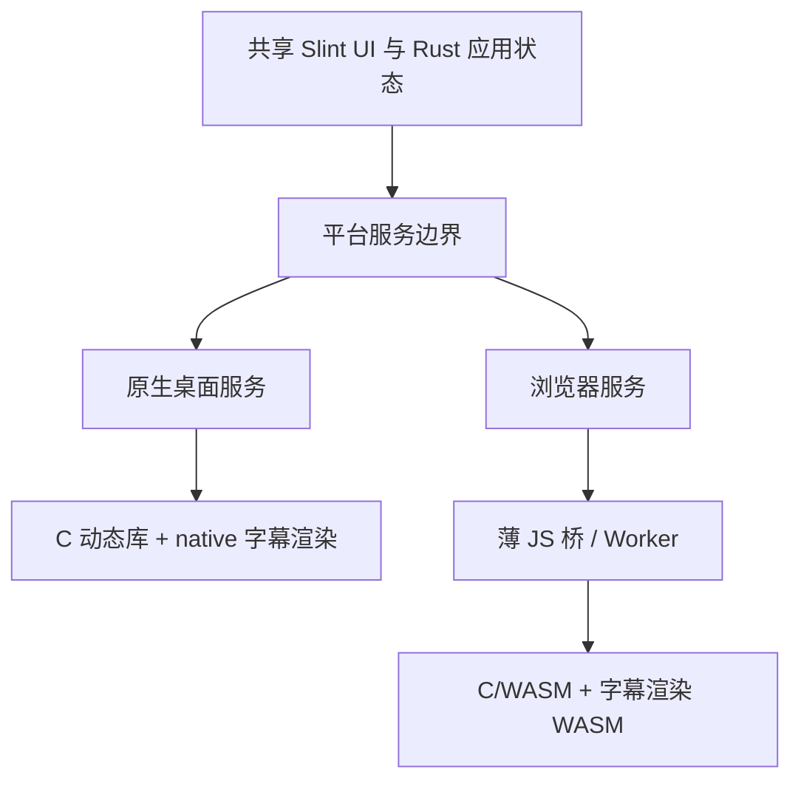

# GUI 框架选型与产品路线 checkpoints

> 统合日期：2026-10-03（Asia/Shanghai）。历史研究日期：2026-10-01。本文来自「比较 Slint 与 Flutter」完整讨论，以及本轮纯文本代码 Review 中与选型有关的事实。
>
> 当前建议是 **Rust + Slint 原生桌面主入口，优先验证共享 Slint UI 的 Web/PWA 兼容入口**。这是根据用户约束形成的建议，**不是用户已经批准的最终技术决策，也不是已经完成的交付状态**。
>
> 本轮没有重新编译、构建、下载框架或发行包，也没有执行测试。本文中的外部平台支持、许可证、浏览器版本和框架能力，均按 **2026-10-01 历史研究记录**引用；发行前应再次核对，不能把本文当作当前支持政策或许可条款的实时查询结果。

## 如何使用这份记录

每个 `DEC-xxx` 是稳定 checkpoint。后续讨论应引用 ID，明确改变了哪个前提、补充了哪项证据、通过了哪项验收，再更新状态。保留推荐演变，避免把不同问题下的建议当作相互矛盾的结论。

状态含义：

- **用户约束已明确**：用户在历史对话中直接表达的偏好或产品定位。
- **条件性建议**：在给定前提下形成的架构判断，尚未正式批准。
- **历史证据**：2026-10-01 的资料或测量记录，本轮未重新验证。
- **本轮文本修复**：源码已修改并做静态复核，尚未运行验证。
- **待实现 / 待验证**：只有候选路线、实现基础或验收要求。

详细的代码问题、修复结果和剩余优先级参见 [代码 Review 台账](03-code-review-and-fixes.md)。本文保留影响框架决策的工程前提，不替代该台账。

## 推荐如何随前提变化

| 阶段 | 当时的问题与新增前提 | 当时建议 | 当前意义 |
|---|---|---|---|
| 1 | 桌面为主，GitHub 在中国连接不稳定；可以复用已有 Flutter GUI，尚未明确语言偏好或几 MB 硬上限 | 复用 Flutter GUI，接入统一 C 核心，保留 Rust CLI | 保留为“复用价值优先”的条件性结论 |
| 2 | 排除已有 GUI 投入，按从零开始考虑；强调界面表达和真实字幕预览；维护者熟悉 C/C++、Python、JS，不熟悉 Rust/Dart | Qt 6 + C++ + Qt Quick/QML；若完整包几 MB 优先，则 Slint + C++ | 建议依赖 C++/JS 技能和接受 QML 的前提 |
| 3 | 用户明确不喜欢 QML、不愿学习 Qt/Dart，更愿学习 Rust；要求尽量兼容旧系统，Win7 可由 Web 覆盖 | Rust + Slint 桌面；先考虑 HTML/JS + C/WASM 兼容版；保留现有 Flutter 移动端 | 语言与维护意愿成为核心条件 |
| 4 | 用户进一步明确桌面是主入口，移动/Web 仅为兼容；希望同一套 UI 生成 Web、可安装为 Web App 并自动更新 | 优先验证 Rust + Slint 共享 UI，生成原生桌面及 Web/PWA；旧浏览器确有问题时再增加简化 HTML UI | 当前推荐方向，仍需原型和兼容验收 |

## DEC-001 · 产品与维护者约束

- **结论**：桌面原生版是主入口；Windows、Linux、macOS 和不同 CPU 架构是目标方向。移动/Web 为兼容入口。用户愿意学习 Rust，不愿学习 Qt/QML 或 Dart；用户希望界面表达较强、能实时看到当前配置对应的字幕转换渲染结果。
- **前提**：这些是用户表达的偏好与方向，没有同时给出完整的支持矩阵、包体积上限、性能阈值或发布预算。用户熟悉 C/C++、Python、JS；“此前不熟悉 Rust”与“更愿意学习 Rust”并不冲突。
- **证据**：历史对话分别提出桌面下载更新、从零选型、语言偏好、Win7/Web 替代和共享 UI/PWA。用户报告 Slint Release 单文件压缩后约 3～4 MB，性质另见 [DEC-014](#dec-014)。
- **状态**：用户约束已明确；具体技术选型仍是条件性建议。
- **待确认 / 验收**：正式确定支持的 OS/CPU/浏览器清单；确定“几 MB”是目标还是硬门槛；确定预览、离线、PWA 安装和原生更新分别进入哪个版本。

## DEC-002 · 第一阶段为什么推荐复用 Flutter

- **结论**：在“可以复用现有 Flutter GUI，尚未要求统一 Rust 或极小完整包”的条件下，复用 Flutter 是合理建议。单凭 GitHub 连通性不足以否决 Flutter。
- **前提**：比较的是现有实现的继续维护成本，不是两个空白项目。现有 Flutter 有页面、预设、状态管理、宽窄布局、配置持久化、后台 isolate 和 Windows 构建基础；Slint 也有文件列表、偏移、设置、日志、进度与配置保存。
- **证据**：历史检查中的 Flutter 本地提交是 `01caa99344cd167f88d3ce1a625407f9945eeb10`；当前重构已提供 [Dart FFI](../../bindings/dart/lib/danmakufactory.dart)，可以直接接统一 C 核心，无需重写转换算法或经过 Rust CLI。Flutter 实际 Windows 发布 ZIP 约 11.78 MiB，见 [DEC-013](#dec-013)。
- **状态**：历史条件性建议；后续用户排除 Dart 后，其优先级下降。这里不是“最终仍应选 Flutter”的声明。
- **待确认 / 验收**：若未来重新考虑 Flutter，须验证迁移 FFI、桌面交互、依赖治理和稳定发布成本；不能只计算已有代码带来的收益而忽略旧桥接和平台插件债务。

## DEC-003 · 从零开始的 Qt 建议及其边界

- **结论**：排除既有 GUI 投入、维护者熟悉 C++/JS、愿意接受 QML，并希望扩展媒体/时间轴/自定义桌面界面时，历史建议是 Qt 6 + C++ + Qt Quick/QML。若小完整包优先，则 Slint + C++ 是另一个合理选择。
- **前提**：该建议依赖维护者愿意学习 Qt/QML，不能在用户后来排除它后继续当作默认方案。它也没有承诺 Qt 的视觉表达一定高于 Flutter。
- **证据**：历史引用 [Qt Quick](https://doc.qt.io/qt-6.10/qtquick-index.html)、[QML 与 C++ 集成](https://doc.qt.io/qt-6.10/qtqml-cppintegration-overview.html)、[QQuickImageProvider](https://doc.qt.io/qt-6/qquickimageprovider.html) 和 [场景图扩展](https://doc.qt.io/qt-6/qtquick-visualcanvas-scenegraph.html)。Qt Widgets 的成熟桌面能力不能全部算到 Qt Quick 上，两者应分别评估：[UI 技术比较](https://doc.qt.io/qt-6.10/topics-ui.html)。
- **状态**：历史条件性建议；被后续用户维护偏好排除为当前主线。
- **待确认 / 验收**：只有用户重新接受 Qt/QML 时才需要重新进入候选。还需核对所用模块许可、打包大小、插件部署及桌面行为，不因 C++ 技能匹配而省略这些成本。

## DEC-004 · 语言偏好使 Rust + Slint 优先

- **结论**：在用户不愿维护 Dart/Qt、愿学习 Rust 的条件下，独立开发 Rust + Slint 桌面 GUI 可行且更符合长期维护意愿。现有 Flutter 不构成必须继续使用它的理由。
- **前提**：Slint 通常仍使用独立的 `.slint` 声明式 UI 语言，业务和平台适配用 Rust；它不是所有代码都用 Rust。若用户反感的是任何独立 UI 描述语言，需要重新考虑 egui。
- **证据**：当前 [Slint GUI](../../gui/slint/src/main.rs)、[UI 文件](../../gui/slint/ui/main.slint)、[Rust 绑定](../../bindings/rust/src/lib.rs) 已形成直接调用 C 核心的实现基础。Slint 还提供正式 C++ 接口，历史引用 [C++ 开发环境](https://docs.slint.dev/latest/docs/cpp/cmake/)；它并不强制每个采用者学习 Rust。
- **状态**：用户语言偏好已明确；Rust + Slint 是当前条件性建议，尚未正式批准或验证为发行就绪。
- **待确认 / 验收**：维护者能够审查 Rust/Slint 的类型、错误、并发和平台代码；明确 AI 辅助的代码审查边界；用真实原型验证复杂交互和图像显示，而不是仅凭“语言愿意学”通过产品验收。

## DEC-005 · 当前推荐是共享 Slint UI 的桌面 + Web/PWA

- **结论**：用户明确“桌面为主，Web/移动为兼容，希望同一套代码”后，建议从“桌面 Slint + 另写完整 HTML UI”调整为“优先验证共享 Slint UI + Web/PWA”。只有实际兼容结果不满足目标时，再增加简化 HTML 入口。
- **前提**：复用目标是共享 UI、状态和业务代码，加平台适配；并不是同一个可执行文件覆盖全部平台，也不是桌面文件/线程 API 原样放进浏览器。
- **证据**：历史 [Slint Web 官方说明](https://docs.slint.dev/latest/docs/slint/guide/platforms/web/)列出桌面为主、Web 为兼容且希望界面一致的适用场景。历史建议中的 Web 构建命令为 `wasm-pack build --release --target web`，本文只是记录，没有执行。
- **状态**：当前条件性推荐；本轮并未把现有桌面 GUI 改造成共享 Web 应用。
- **待确认 / 验收**：验证同一套配置面板和预览区能在原生与浏览器运行；验证窄屏、触摸、键盘和旧浏览器；确定平台服务接口和 Web Worker 路线；在失败证据出现前不预先承担两套完整 UI 的维护成本。

## DEC-006 · 界面表达能力比较

- **结论**：历史判断是 Flutter 在常规可直接使用的复杂自定义 UI、动画、自由绘制和组合便利性上更强；Qt Quick 同样有很强的视觉和扩展能力；Slint 足以承担本工具的文件/参数/时间轴/图像预览，但复杂编辑器可能需更多自建交互。
- **前提**：“开发便利和现成表达手段更丰富”不是“Slint 不能画出某种画面”，也不是已有项目的功能完成度排名。
- **证据**：历史引用 Flutter 的 [CustomPainter](https://api.flutter.dev/flutter/rendering/CustomPainter-class.html)、[片元着色器](https://docs.flutter.dev/ui/design/graphics/fragment-shaders)、[Texture](https://api.flutter.dev/flutter/widgets/Texture-class.html)，Slint 的 [Image / 像素缓冲接口](https://docs.slint.dev/latest/docs/cpp/api/slint/image/)，以及 DEC-003 中的 Qt 图形扩展资料。
- **状态**：历史能力研究与架构判断；没有三个同功能实现的帧率、内存或复杂交互对照。
- **待确认 / 验收**：以本产品的任务验证：宽屏参数 + 预览布局、窄屏折叠布局、时间轴拖动、快捷键、错误展示和图像刷新。避免以框架演示页面代替应用体验验收。

| 维度 | Flutter | Slint | Qt Quick/QML |
|---|---|---|---|
| 自定义视觉和复杂动画 | 组合与绘制接口充分 | 常用效果可做，复杂扩展可能需自行补齐 | 动画、场景图、图形扩展路径充分 |
| 自由二维绘制 | Canvas / CustomPainter / shader | 图形元素与外部图像 | QML 图形元素与 C++ 场景图 |
| 显示真实 ASS 渲染输出 | 可行 | 可行 | 可行 |
| 当前维护者的学习成本 | Dart/Flutter，用户不愿长期投入 | Rust + .slint，用户愿学习 Rust | C++ 可复用，QML/Qt 被用户排除 |
| 小体积发行 | 引擎和资源需计入 | 有较大的精简空间 | Qt 库、插件、QML 模块需计入 |
| 当前主线地位 | 保留为备选和既有移动端基础 | 当前推荐 | 不符合当前用户约束 |

## DEC-007 · 真实字幕预览不是 GUI 框架自带的结果

- **结论**：预览应显示“当前配置生成的真实 ASS，被字幕渲染器按时间戳渲染后的画面”。不能仅用 GUI Text 控件模拟字幕后称为转换结果预览。
- **前提**：准确性主要受 ASS 标签、字体替换、描边、阴影、运动、排版、分辨率和目标渲染器影响。GUI 能显示图像，不等于其文字控件能正确实现 ASS 语义。
- **证据**：[C 公开 API](../../lib/include/danmakufactory.h)提供配置和文件转换，尚未提供公开 `render_frame`、内存 ASS 返回或预览会话接口。[文本测量](../../lib/src/text/measure.c)用于布局测量，不能代替完整字幕渲染。历史候选 [libass](https://github.com/libass/libass/blob/master/README.md)提供 ASS/SSA 渲染，[API](https://github.com/libass/libass/blob/master/libass/ass.h)支持内存脚本和按时间戳产生字幕图像。
- **状态**：架构建议；本轮没有添加 libass、实时预览或渲染 API。
- **待确认 / 验收**：第一版采用纯色或图片背景，暂不同时引入完整视频解码；用代表性字幕、相同字体和渲染尺寸对照目标播放器；确认预览何时刷新、每帧如何合成、图像内存由谁释放。

## DEC-008 · 预览计算与转换计算应分开调度

- **结论**：改参数时合并连续刷新请求，在后台重新生成字幕；播放/拖动时间轴时复用已生成 ASS，仅渲染对应时刻。后续可以增加解析缓存与内存输出，减少重复解析和临时文件。
- **前提**：当前文件转换 API 可以作为早期原型基础，但高频预览不能默认每次拖动都重新解析输入、落盘、读取并完整转换。桌面线程和 Web Worker 的调度实现不同。
- **证据**：DEC-007 的共享渲染路径和当前 [处理实现](../../lib/src/core/process.c)。浏览器的普通 Rust 文件系统/线程限制按历史 [wasm32-unknown-unknown 说明](https://doc.rust-lang.org/rustc/platform-support/wasm32-unknown-unknown.html)记录。
- **状态**：待实现；没有获得延迟、吞吐、峰值内存或 UI 流畅度数据。
- **待确认 / 验收**：定义取消和过期结果丢弃规则，连续配置变化时仅提交最新结果；区分转换进度与预览播放时间；验证关闭窗口、切换输入、字体加载失败时的资源生命周期。性能阈值须由产品目标确定，不在本文凭空指定。

## DEC-009 · C 核心保持独立，框架选择不重写转换算法

- **结论**：Flutter、Slint、Qt、Web 都可共享 C 转换源码与配置语义；选 GUI 的成本主要在调用、状态、布局、平台能力和发行层。Flutter 可以直接走 Dart FFI，Slint 走 Rust FFI，Qt 可以薄 C++ 适配；浏览器需 C/WASM。
- **前提**：原生动态库与 WebAssembly 产物不是同一个二进制。浏览器无法直接加载 Windows DLL；统一 C 核心不自动保证原生与 WASM 依赖和行为完全一致。
- **证据**：[C API](../../lib/include/danmakufactory.h)、[Rust 绑定](../../bindings/rust/src/lib.rs)、[Dart 绑定](../../bindings/dart/lib/danmakufactory.dart)、[JS/WASM 绑定](../../bindings/javascript/danmakufactory.mjs)、[xmake 构建目标](../../xmake.lua)。
- **状态**：多语言绑定和 C/WASM 基础已存在；部分绑定本轮做了文本修复；完整平台运行一致性待验证。
- **待确认 / 验收**：以相同 fixtures 比较原生/WASM 的转换、配置、过滤、字体和错误行为。API 需明确错误获取的线程局部语义、句柄并发规则、字符串/缓冲区所有权和版本/能力边界。

## DEC-010 · Flutter 桌面适配与移动端可以共存

- **结论**：开发 Flutter 桌面端不会天然破坏移动端。共享配置、转换任务和状态，按窗口空间及平台能力调整布局，是合理路线；用户不愿长期维护 Dart，才是当前降低 Flutter 优先级的主要原因。
- **前提**：把固定桌面尺寸、绝对路径、仅 Windows 插件或鼠标专用操作写进共享代码才会造成兼容问题。不能只按 OS 判断布局，桌面小窗口与移动大屏也需考虑。
- **证据**：历史 Flutter 源码在宽度 `600` 时使用 NavigationRail，窄屏使用 BottomNavigationBar：外部历史布局文件 `D:/Shawn/Source/Repos/hihkm/DanmakuFactory/gui/danmakufactory_flutter/lib/ui/screen/main/index/main_screen.dart`。历史 [Flutter 桌面输入文档](https://docs.flutter.dev/ui/adaptive-responsive/input)涵盖焦点、键盘、快捷键和鼠标。
- **状态**：历史源码事实与设计建议；外部历史 Flutter 仓库本轮未修改；记录的本机路径仅用于说明历史检查对象，不是本仓库的可访问源码链接。
- **待确认 / 验收**：若保留 Flutter 移动端，明确其支持责任、配置版本及共享 fixtures；桌面左参数/右预览，移动分步/折叠参数的建议不等于已实现。当前 Dart 原生插件使用 dart:ffi/dart:io，Web 仍需另设 WASM 后端。

## DEC-011 · AI 辅助不会使 Flutter 必然淘汰

- **结论**：“AI 是万能翻译器，所以 React Native 等抽象层必然退场，Flutter 也应弃用”的推论缺乏依据。应按维护意愿、平台覆盖、能力和发行成本选型，不按这句预言弃用框架。
- **前提**：Flutter 桌面 Release 将 Dart 应用与框架代码 AOT 编译为机器码，通常由自身布局和绘制控件。引擎、运行时与 GC 和“持续把 Dart UI 翻译为原生控件”不是同一个概念。
- **证据**：历史 [Flutter 架构说明](https://docs.flutter.dev/resources/architectural-overview)；Slint 也有布局、属性和绘制运行时，存在编译/解释集成：[Slint 集成方式](https://docs.slint.dev/latest/docs/cpp/overview/)；Qt Quick 也使用 QML 引擎。
- **状态**：架构判断，不是对任何框架未来市场寿命的预测。
- **待确认 / 验收**：即使 AI 能生成或翻译代码，仍需验证文字排版、图层合成、输入法、焦点、无障碍、动画、状态、平台差异和维护。AI 同时降低 Flutter、Slint、Qt 和原生 UI 的写代码成本，不能代替维护者理解生成代码。

## DEC-012 · 维护成本与源代码行数

- **结论**：Rust + Slint 的价值包括让 CLI/GUI 共用 Rust 绑定、错误类型和工具链；Flutter 增加 Dart、状态管理、插件和原生构建层。行数只描述实现规模，不能直接代表质量或长期成本。
- **前提**：维护栈集中有利，但 C 核心、字体、字幕渲染、OS 适配、WASM 和发行管线仍存在。选 Rust 不会消除跨平台工程工作。
- **证据**：历史统计 Slint 三个主要实现文件约 1,374 行，Flutter 约 2,491 行手写 Dart，另有状态管理生成代码；这些是历史数值，本轮新增/修复后没有重做统计。当前 [GUI Cargo 依赖](../../gui/slint/Cargo.toml)与 [Rust 绑定](../../bindings/rust/src/lib.rs)可核对实际边界。
- **状态**：历史实现规模证据与维护判断。
- **待确认 / 验收**：以依赖升级、错误定位、插件维护、跨架构构建、交互补齐和发布恢复的实际工作量比较。避免把较少行数或一种业务语言直接写成“更可靠、更快”。

## DEC-013 · 历史包体积测量证据

- **结论**：历史测量显示 Flutter Windows 正式 ZIP 约 11.78 MiB；本地历史 Slint EXE 与已有 C DLL 的组合 ZIP 约 8.05 MiB。这支持 Slint 有精简潜力，但不能支持同功能完整产品的严格性能排名。
- **前提**：双方不是同版本、同核心、同功能、同渲染器配置对照。Slint 组合不属于经过完整构建验证的正式 release；两组 ZIP 均未包含完整 VC runtime 成本。
- **证据**：[历史测量证据副本](evidence/framework-measurements-20261001.json)和历史 [Flutter v1.70.2 Release](https://github.com/hihkm/DanmakuFactory/releases/tag/v1.70.2)。本轮仅读取已保存 JSON，没有重新下载或构建。
- **状态**：历史证据；不能作为当前源码的发行包大小或运行验证。
- **待确认 / 验收**：正式比较前固定源码、C 核心、功能、字体、渲染器、release 优化和运行库部署条件，按 OS/架构分别打包测量；同一组首次安装与增量更新分开统计。

以 `1 MiB = 1,048,576 bytes` 表示：

| 测量项 | 原始 bytes | 约 MiB | 性质 |
|---|---:|---:|---|
| Flutter Windows ZIP | 12,356,561 | 11.78 | 发布包 |
| Flutter Windows 解压后合计 | 29,477,885 | 28.11 | 18 个文件 |
| Flutter 引擎 flutter_windows.dll | 19,036,160 | 18.15 | 解压后单文件 |
| Flutter 引擎 ZIP 条目 | 8,148,515 | 7.77 | 该条目压缩数据量 |
| Flutter Dart app 文件 | 6,128,560 | 5.84 | 解压后应用部分 |
| Flutter Dart app ZIP 条目 | 2,412,335 | 2.30 | 该条目压缩数据量 |
| Flutter 包中的旧核心 | 398,336 | 0.38 | 与当前核心不是同构建 |
| Slint 历史 GUI EXE | 17,015,808 | 16.23 | 未与当前源码对应 |
| Slint 配对的已有 C DLL | 2,433,536 | 2.32 | 未重新构建验证 |
| Slint 历史两文件组合 ZIP | 8,445,439 | 8.05 | 非已验证正式发行 |
| Slint 两文件解压后合计 | 19,449,344 | 18.55 | 不含完整 runtime |

测量记录还保存了：

- 当前仓库基线 `e2d0cd95f46550b094c890781ea385656f8021e8`。
- Flutter 本地源码提交 `01caa99344cd167f88d3ce1a625407f9945eeb10`，比公开发布包旧；不能把本地源码和发布包当作同一个对象。
- Slint 锁定版本 `1.17.1`；历史二进制观察到 accessibility、backend-default、renderer-femtovg、renderer-software、system-tray 等 features。
- `slint_exe_matches_current_source=false`，`paired_slint_archive_is_verified_release=false`。
- 2026-10-01 的 fresh release 重建因未找到 Visual Studio C++ 工具链失败，没有产生新 Slint/Flutter 运行基准。
- 未测 RAM、启动时间、空闲 CPU、网络成功率或新 GUI 功能验证。本轮也未补这些测量。

历史对话还报告了 Flutter Linux 发布包约 22.40 MiB、macOS 约 49.58 MiB；这两项没有写入上述本地 JSON，本文保留为当时 Release 查询记录，不能当作本轮核验的原始测量。Windows 结果不能直接外推 macOS/Linux。

`build/` 是构建证据目录，可能不随仓库分发；因此本文保留原始数字和限制。对外发布文档时，若需可独立审计，应另行保存正式测量附件及哈希，而不是要求读者依赖未提交的本机文件。

## DEC-014 · 用户报告的 Slint 3～4 MB

- **结论**：用户报告 Slint Release 单文件压缩后约 3～4 MB，应认可这是重要的体积观察和目标输入。本文没有重新测量它，不能用 DEC-013 的不同历史组合否定用户报告，也不能把它升级为完整产品的保证。
- **前提**：需要区分 GUI 单文件、静态/动态核心、ZIP 格式、MiB/MB、runtime、字体、预览组件和完整发行物。加入 libass、打包字体或视频组件会改变下载量。
- **证据**：历史用户直接陈述；没有给出与当前功能匹配的该次构建配置、档案哈希或全部发行文件清单。
- **状态**：用户报告，未重测。
- **待确认 / 验收**：在约定功能及干净目标系统上测完整包。若“完整离线包 ≤ 某阈值”成为硬门槛，应写入质量/发布约束，并同时计入首次运行需要下载的依赖，不能只统计外壳 EXE。

## DEC-015 · 组件独立更新是架构能力，不是 Flutter 独占优势

- **结论**：只更新兼容 C DLL、只更新 GUI/UI 部分、框架升级才提供完整包，Flutter、Slint、Qt 都可通过部署和更新器设计实现。首次 ZIP 大小不等于每次更新流量。
- **前提**：必须满足 ABI 和组件版本兼容。如果 C 核心静态链接进 Slint EXE，核心修改需要更新 EXE；改用 GUI EXE + C DLL 才能独立替换核心。单文件是部署选择，不是 Slint 的必然限制。
- **证据**：历史 Flutter Windows 包的引擎、data/app.so、资源分离；[Windows 产物说明](https://docs.flutter.dev/platform-integration/windows/building)。历史 [Flutter FAQ](https://docs.flutter.dev/resources/faq)不保证跨编译器版本 ABI，且没有内置 code push。Slint 可选择运行时加载 UI 描述，Qt 可设计外置 QML，但这些都需自建兼容与更新控制。
- **状态**：架构建议；当前新 GUI 没有完成这种组件更新机制，不能把它记作已有 Flutter 或 Slint 功能。
- **待确认 / 验收**：明确完整包、核心包、GUI 包、框架升级包的清单；校验版本组合；验证升级/降级/中断恢复。UI 动态加载、应用部分下载更新和任意热更新是不同概念，不应混用。

| 更新类型 | Flutter | Slint | Qt |
|---|---|---|---|
| 兼容的 C 核心独立更新 | 可设计 | 动态链接时可设计 | 动态链接时可设计 |
| 框架不变，应用/UI 修改 | 按变更文件设计，引擎/插件须匹配 | 更新 GUI EXE，保留兼容 C DLL | 更新应用，保留兼容 Qt 库 |
| UI 描述运行时加载 | 与 code push/编译产物兼容问题分开判断 | 可选择解释/动态加载路线 | 可设计外置 QML |
| 自动更新是否已由本项目实现 | 未完成 | 未完成 | 尚非本项目主线 |

## DEC-016 · C ABI、版本和能力查询是独立更新的前置契约

- **结论**：独立 C 更新需另立 ABI 与能力约定；`df_get_version()` 的产品版本字符串不足以自动证明某个 GUI 与某个核心能安全组合。
- **前提**：GUI 调用符号、参数布局、错误语义和内存所有权必须稳定，新增能力应能查询或安全降级。更新器不能仅看版本号大小就接受组件组合。
- **证据**：[公开 C API](../../lib/include/danmakufactory.h)及 [版本/错误实现](../../lib/src/base/error.c)；当前线程局部错误查询和不同句柄并发契约是已有边界，但不等于完整的更新 ABI 政策。
- **状态**：已有基础 API；完整 ABI 兼容规则和能力协商待设计、验证。
- **待确认 / 验收**：规定 API/ABI 版本、必需符号、可选能力、UTF-8、调用方/库内存归属、线程规则；用旧 GUI + 新兼容核心、新 GUI + 旧核心、失配版本和安装回滚测试组合。发布清单应覆盖 GUI/C/预览渲染器的版本关系。

## DEC-017 · GitHub 网络问题不会被换 GUI 框架消除

- **结论**：小包减少传输时间和重试成本，但 DNS、TLS、连接建立、API 请求、重定向和发行资源下载失败仍需下载链路处理。选择 Flutter/Slint 与选择可靠发行策略是两项决策。
- **前提**：用户在中国连接 GitHub 不稳定是本项目的明确场景；没有测量不同框架包的实际下载成功率，也没有证明任意镜像能稳定解决问题。
- **证据**：历史 [GitHub Release assets 接口](https://docs.github.com/en/rest/releases/assets)涉及下载/重定向；[API 限流说明](https://docs.github.com/en/rest/using-the-rest-api/rate-limits-for-the-rest-api)在历史研究中记录匿名 REST 常规每来源 IP 每小时 60 次。该数字是历史政策记录，发行前需重查。Flutter [中国镜像说明](https://docs.flutter.dev/community/china)解决开发 SDK/依赖获取，不自动加速本项目的 GitHub 安装包。
- **状态**：问题与架构建议已记录；更新器和网络验证未完成。
- **待确认 / 验收**：后台检查失败不阻止本地转换；超时、有限重试、取消、重定向处理、缓存版本信息；服务器支持时断点续传；完整性与真实性验证；失败恢复、保留旧版、手动下载入口。可替换下载源或维护者控制镜像是否允许，需要明确产品和运维责任。

## DEC-018 · 首次安装必须计算运行库与完整离线成本

- **结论**：小 EXE/ZIP 不等于干净系统可以离线启动。应把 C 核心、系统/VC runtime、插件、字体和预览依赖纳入部署验证。
- **前提**：开发机往往已有 runtime，不能作为干净系统证据。不同渲染器 features 会改变包体和依赖；不能用单个历史 artifact 推断所有配置。
- **证据**：历史测量观察 Flutter runner 依赖 MSVCP140.dll、VCRUNTIME140.dll、VCRUNTIME140_1.dll，Slint 依赖 VCRUNTIME140.dll；当时 Flutter ZIP 未附带所需几个 runtime DLL。历史 [Flutter Windows 部署](https://docs.flutter.dev/platform-integration/windows/building)和 [Slint 渲染器说明](https://docs.slint.dev/latest/docs/slint/guide/backends-and-renderers/backends_and_renderers/)提示实际部署及 Skia 等 renderer 的成本。
- **状态**：历史导入表观察；本轮做了 DLL staging/rpath 的文本调整，尚未在干净 OS 上验证，更不能保证 xrepo 全部动态依赖已闭环。
- **待确认 / 验收**：安装与首次启动无需额外联网的完整包测试；区分首次完整包和组件更新；验证 fontconfig/freetype/harfbuzz/libass 等所用构建的许可及 runtime。若仍需网络安装依赖，应计入真实首次使用成本。

## DEC-019 · Flutter 的许可管理相对简单，但不是只有项目 MIT

- **结论**：历史研究记录 Flutter 框架为 BSD 3-Clause，适合继续保留本项目自身 MIT；引擎和第三方依赖仍需各自遵守声明和发行要求。
- **前提**：该结论不代表每个插件和生成发行物都自动采用 BSD/MIT。依赖版本、fork 和平台专用包影响实际许可清单。
- **证据**：[本项目 LICENSE](../../LICENSE)，历史 [Flutter 许可 FAQ](https://docs.flutter.dev/resources/faq#which-software-licenses-apply-to-flutter-and-its-dependencies)。
- **状态**：2026-10-01 历史许可研究；不是本轮重新做的法律或依赖审计。
- **待确认 / 验收**：针对最终锁定版本和打包文件生成许可清单；保留引擎、字体、第三方组件声明。若“仅宽松许可、最小发行管理成本”成为最高优先级，Flutter 仍值得重新进入比较。

## DEC-020 · Qt 的 LGPL/GPL/商业路径须按模块选择

- **结论**：历史研究记录常规 Qt Qml/Quick/Quick Controls 有 LGPLv3 选项；满足条件时，本项目自身代码可以保持 MIT，不应笼统声称使用 Qt 必须整体改 GPL。
- **前提**：额外模块需逐个核查；许可声明、对应 Qt 源码获取和用户替换兼容库等义务有发行成本。动态链接通常更易管理，但不等于免除义务。
- **证据**：历史 [Qt Quick Controls 许可](https://doc.qt.io/qt-6.10/qtquickcontrols-index.html)、[Qt LGPL 义务](https://www.qt.io/development/open-source-lgpl-obligations)。
- **状态**：历史研究；Qt 当前不是符合用户维护偏好的主候选。
- **待确认 / 验收**：如重新采用 Qt，按最终版本/模块/链接/发行方式重新核查。不能把 Qt 的许可复杂度解释成技术上不可用，也不能忽略它以只看熟悉 C++ 的收益。

## DEC-021 · Slint 许可需要明确采用哪条路径

- **结论**：项目本身 MIT 不意味着 Slint 必须付费，也不意味着只写 MIT 就完成 Slint 的发行要求。历史讨论涉及 GPLv3、专门免版税/免费应用许可及其他许可路径，需要明确选择。
- **前提**：希望应用保持自身 MIT 时，历史建议是研究涵盖桌面、移动、Web 的免版税应用许可，并履行 AboutSlint 或公共网页徽章等归属展示条件。它不是通用 MIT/BSD，存在许可范围。
- **证据**：历史 [Slint LICENSE.md](https://github.com/slint-ui/slint/blob/master/LICENSE.md?plain=1)、[Slint 免版税许可 PDF](https://slint.dev/agreements/slint-royalty-free-license.pdf)。历史首轮“免费桌面许可”与后续更广的应用许可应按实际条款核对，不能仅凭简称判断 Web 部署适用性。
- **状态**：历史许可研究，最终所用许可尚待记录；本轮没有新增正式许可选择或合规证明。
- **待确认 / 验收**：在最终 release 版本确认条款、用途、归属展示、链接/通知和第三方依赖；桌面/About 与公开 Web 页面分别核对。许可证文件内容可能变化，发行前需重新读取适用版本，不把历史链接当永久条款快照。

## DEC-022 · Win7 原生支持不能由当前常规工具链自动保证

- **结论**：历史研究没有依据把当前 Flutter/Slint 常规原生版承诺为 Win7 支持版。用户接受 Web 替代时，不建议主桌面版本为了 Win7 长期锁住旧工具链。
- **前提**：“没有官方支持/测试保证”不等于“绝对不能启动”；专项 Win7 支持需要逐层证明。软件 renderer 只能解决部分图形问题，不能解决 OS API、窗口/对话框/C 库/runtime 等所有限制。
- **证据**：2026-10-01 历史 [Flutter 平台矩阵](https://docs.flutter.dev/reference/supported-platforms)记录 Windows 10/11，不支持 Win7；[Slint Windows 测试矩阵](https://docs.slint.dev/latest/docs/slint/guide/platforms/desktop/windows/general/)仅列 10/11；[普通 Rust Windows 目标](https://doc.rust-lang.org/stable/rustc/platform-support/windows-msvc.html)与 [Win7 Tier 3 目标](https://doc.rust-lang.org/stable/rustc/platform-support/win7-windows-msvc.html)有不同支持条件，历史记录专用目标需自行构建标准库等。
- **状态**：历史支持研究；没有 Win7 真实机器测试，也没有 Win7 专项构建。
- **待确认 / 验收**：若正式要求 Win7 原生版，建立独立支持矩阵，验证窗口后端、图形驱动、文件对话框、C 核心、runtime、预览器和更新器，并明确维护成本。否则产品应标明现代 OS 原生版 + 经验证浏览器兼容入口。

## DEC-023 · 旧浏览器目标必须具体，不能写“支持所有 Win7 浏览器”

- **结论**：历史讨论建议把 Win7 Firefox 115 ESR 和 Chrome 109 作为明确候选测试目标，另覆盖当前现代浏览器；不承诺 IE11 或任意旧浏览器。
- **前提**：浏览器运行能力、安全维护周期、PWA 安装能力是三件事。网页能运行不等于能安装成独立窗口，也不等于仍获安全更新。
- **证据**：2026-10-01 历史 [Mozilla 说明](https://support.mozilla.org/en-US/kb/firefox-users-windows-7-8-and-81-moving-extended-support)当时记录 Win7 ESR 115 安全更新至 2027 年 3 月、之后再评估；[Chrome 系统要求](https://support.google.com/chrome/a/answer/7100626?hl=en)记录 Chrome 109 为最后 Win7 路线。历史 [Firefox Web Apps](https://support.mozilla.org/en-US/kb/web-apps-firefox-windows)讨论指出 ESR 115 不具备后来 Windows Web Apps 的独立窗口能力。这些政策均未在本轮重新核查。
- **状态**：历史候选支持矩阵，未验证本项目页面/Slint WASM/字幕预览在这些浏览器实际运行。
- **待确认 / 验收**：基础路径使用普通文件选择、字体文件导入、结果下载和 Worker；不能把 WebGPU、直接目录访问、系统字体枚举列为必需能力。分别测试功能、字体、性能、WebGL、离线和安装；不支持安装时提供普通网页模式。

## DEC-024 · Slint Web 与 Flutter Web 都需要平台适配

- **结论**：共享 UI 能减少重复开发，但两者都不能把原生 FFI、路径、后台线程和插件原样用于浏览器。Slint Web 的 Canvas/WebGL 也不等同于普通 HTML/CSS 控件的集成、可访问性和旧浏览器特性。
- **前提**：Web 为兼容入口的定位允许合理精简，但不能静默改变转换含义。数据通常通过用户提供的字节进入虚拟 FS；下载与字体权限受浏览器约束。
- **证据**：历史 [Slint Web 限制](https://docs.slint.dev/latest/docs/slint/guide/platforms/web/)、[Rust WASM 目标限制](https://doc.rust-lang.org/rustc/platform-support/wasm32-unknown-unknown.html)、[Flutter Web 支持矩阵](https://docs.flutter.dev/reference/supported-platforms)。现有 Flutter 原生插件使用 dart:ffi/dart:io：外部历史插件文件 `D:/Shawn/Source/Repos/hihkm/DanmakuFactory/gui/danmakufactory_flutter/danmakufactory/lib/danmakufactory.dart`。
- **状态**：历史能力判断；平台服务抽取与共享 Web UI 待实现。
- **待确认 / 验收**：建立 FileService、ConversionService、FontService、PreviewService、StorageService、UpdateService 等所需边界，名称可随实现调整。关注可访问性、键盘/输入法和 Canvas 图像更新；用验证决定是否需要简化 HTML 备用 UI。

| 能力 | 原生桌面适配 | 浏览器适配 |
|---|---|---|
| 文件输入 | 路径与 native 文件选择 | 用户选择/拖入后的字节 |
| 结果保存 | 文件/目录写入 | Blob 下载，选用可选高级 API |
| 核心转换 | C DLL/SO/dylib + FFI | C/WASM + 薄 JS 桥 |
| 系统字体 | native 字体发现 | 字体文件或有权限的可选枚举 |
| 后台计算 | native 工作线程 | Web Worker，消息与字节传输 |
| 预览 | native libass / 图像或纹理 | libass/WASM / Canvas 或 RGBA |
| 配置持久化 | 原生配置文件 | 浏览器存储，导入/导出 |
| 更新 | 原生组件更新器 | Service Worker 资源版本管理 |

## DEC-025 · 双 WASM + 薄 JS 桥是共享路线的可验证候选

- **结论**：候选架构是 Rust/Slint UI WASM + Emscripten C 核心 WASM，由薄 JS 桥处理文件字节、Worker 通信和下载。JS 不需要重新实现完整业务 UI，转换可以在浏览器本地完成而不上传服务器。
- **前提**：两份 WASM 及其各自内存、字体/VFS和通信生命周期需清楚管理；“同一套代码”主要指 UI 与应用逻辑共享，平台 glue 仍存在。
- **证据**：当前 [xmake 的 C/WASM 目标](../../xmake.lua)、[JS 绑定](../../bindings/javascript/danmakufactory.mjs)、[已有独立 HTML 页面](../index.html)。当前 [Slint main](../../gui/slint/src/main.rs)还包含原生 FS、同步对话框和线程操作，尚未平台抽取。
- **状态**：条件性架构建议；共享 Slint Web UI、双 WASM 和 Worker 尚未形成经验证的产品。
- **待确认 / 验收**：配置/状态 Rust 代码在两端共享；文件字节传输、消息序号、错误和取消一致；避免大文件重复拷贝；验证字体供给与 preview 图像生命周期。若选择其它 bridge 方案，应记录实际复杂度与一致性证据。

## DEC-026 · SPA、PWA 安装、离线和自动更新分别验收

- **结论**：同一 Web 构建可以作为普通 SPA，也可包装成可安装 PWA；Canvas/WebGL UI 不与 PWA 本身冲突。但能安装不自动意味着离线，离线缓存不自动意味着任务安全的更新。
- **前提**：可安装能力依浏览器不同；旧浏览器可退化为普通网页。Web App Manifest、图标、启动地址和 display 配置解决身份/启动，HTTPS 提供受支持的部署环境，Service Worker 承担缓存/生命周期设计。
- **证据**：历史 [PWA 安装要求](https://developer.mozilla.org/en-US/docs/Web/Progressive_web_apps/Guides/Making_PWAs_installable)、[Service Worker 更新处理](https://developer.chrome.com/docs/workbox/handling-service-worker-updates)。历史 [Flutter Web FAQ](https://docs.flutter.dev/platform-integration/web/faq)记录 Flutter 不再默认生成/管理离线缓存 Service Worker；Flutter 路线也需配置离线和更新。
- **状态**：PWA 为待实现功能；当前独立 HTML/C/WASM 页面不能被写成已完成的可安装离线产品。
- **待确认 / 验收**：分别验证普通在线网页、安装后独立窗口、首次缓存后的完全离线转换、失败网络继续旧版、更新提示与保存配置。完整缓存 UI/WASM/字体/预览资源后才可承诺离线；不依赖外部 CDN 才能消除该运行时网络依赖。

## DEC-027 · PWA 更新必须按完整版本切换

- **结论**：推荐打开时检查，后台获取变化资源；全部资源可用后，在当前转换结束或下次启动时保存状态并启用新版。网络失败继续旧缓存；不在转换中强制刷新。
- **前提**：UI、C/WASM、渲染器和资源属于有兼容关系的版本集合。Service Worker 的安装、等待、启用生命周期需与应用任务状态协调。
- **证据**：历史 [Workbox 更新处理](https://developer.chrome.com/docs/workbox/handling-service-worker-updates)，以及 DEC-016 的组件兼容前提。
- **状态**：更新策略建议；未实现、未验证。按文件版本缓存不等于已有 WASM 二进制差分更新；应用关闭后持续实时更新也没有保证。
- **待确认 / 验收**：资源缺失/下载中断不激活半个版本；旧任务不中断；切换保留配置；更新失败可恢复；多个页面或标签的版本一致性有明确规则。PWA 只更新 Web 资源，原生 EXE/C 动态库仍需要独立更新器。

## DEC-028 · 移动兼容入口与 Slint 布局

- **结论**：在移动是兼容入口的前提下，可以先用 Web/PWA，暂不开发独立移动应用；共享 Slint UI 仍需窄屏与触摸适配。
- **前提**：桌面版的大任务、目录处理和快捷键优先；移动的内存、浏览器权限和触摸操作有不同限制。PWA 不解除这些限制。
- **证据**：[当前 Slint UI](../../gui/slint/ui/main.slint)保留最小宽度 800、最小高度 600，是桌面布局；不能据此宣称移动适配完成。Flutter 宽窄布局已有历史基础，见 DEC-010。
- **状态**：产品定位已明确，移动布局待实现。
- **待确认 / 验收**：分步/折叠参数、可触摸时间轴、日志与预览空间、虚拟键盘/输入法；大文件限制和内存失败反馈；在窄窗口与真实手机浏览器验证。已有 Flutter 移动端是否继续发布属于单独维护决策，不因 Web/PWA 建议而自动删除。

## DEC-029 · Win7/Web 预览候选 JASSUB

- **结论**：历史讨论保留 JASSUB 作为 Web libass/WASM 预览候选，可给 Canvas 传时间戳，不必须绑定视频。
- **前提**：历史文档中列出的浏览器最低版本只是候选兼容依据，不能代替本项目整合和目标浏览器运行结果；C 转换、字体与 UI WASM 也可能提出更高要求。
- **证据**：2026-10-01 历史 [JASSUB 官方项目](https://github.com/ThaUnknown/jassub)记录 Chrome 80、Firefox 105 等最低版本，理论上覆盖候选 Chrome 109/Firefox 115。libass 历史 [ISC 许可](https://github.com/libass/libass/blob/master/COPYING)也应进入最终依赖清单；JASSUB 及打包依赖仍需分别核查。
- **状态**：候选，未安装、未集成、未本轮验证。
- **待确认 / 验收**：选择确定版本；验证纯背景/静态图预览、字体导入、时间戳控制、后台 Worker、取消/销毁与旧浏览器。若满足 RGBA 统一接口，便于两端共享预览区，否则记录额外 bridge 成本。

## DEC-030 · egui、C++ WebView 和 Tauri 仍是有条件备选

- **结论**：不是只能在 Flutter/Slint 二选一。egui + eframe 适合希望界面也写 Rust 的参数工具；C++ + WebView + JS 贴合既有 C++/JS 技能；Tauri 是 Rust/Web UI 候选，但不能把它作为 Win7 自动解决方案。
- **前提**：备选各有表达、依赖和平台代价，不能以“外壳几 MB”代表完整部署，也不能把 egui 当 Slint 视觉能力的无条件升级。
- **证据**：历史 [egui/eframe](https://github.com/emilk/egui/blob/main/README.md)说明原生/Web/WASM及 MIT/Apache-2.0；[C/C++ WebView](https://github.com/webview/webview)；[WebView2 部署要求](https://learn.microsoft.com/en-us/microsoft-edge/webview2/concepts/distribution)；历史 [Tauri 2.12 说明](https://tauri.app/blog/tauri-2.12/)记录已放弃 Win7。本轮未复核这些外部支持政策。
- **状态**：保留候选，未做同功能原型、大小或性能测量。
- **待确认 / 验收**：若不愿学习 .slint，先比较 egui 的纯 Rust UI 与目标外观；若使用 WebView，验证不存在 runtime 时的离线发行及真实字幕图像接入；若 Tauri，确认现代 OS 支持和 Web 前端维护意愿。Python 技能是已有背景，不足以自动推导某个 Python GUI 框架为最佳，历史没有完成该类对照。

| 备选 | 适合的优先条件 | 主要代价 / 当前边界 |
|---|---|---|
| egui + eframe | Rust UI、参数面板、时间轴/图像工具 | 复杂成品外观需更多定制；未实测 |
| Slint + C++ | C++ 技能、小包，不想学习 Rust | 需 .slint；当前用户更愿学 Rust |
| C++ + WebView + JS | HTML/CSS 表达与已有技能 | 系统 WebView/runtime成本、原生预览桥接 |
| Tauri + Web UI | Rust业务与共享网页UI | 不自动覆盖 Win7；需Web前端/runtime策略 |
| Flutter | 宽松许可、丰富绘制、复用既有UI | 用户不愿长期学Dart；原生/Web仍需适配 |
| Qt Quick/QML | C++/JS、媒体扩展、接受QML | 用户明确排除；许可/包体成本需管理 |

## DEC-031 · 现有实现问题与框架能力要分开记录

- **结论**：实现 bug、发行缺口和测试不足不能直接证明某框架不适合。它们应进入修复台账；选择任何框架都需完成对应工程。
- **前提**：历史 Flutter 和当前 Slint 来自不同仓库/版本/功能成熟度。本轮只修改当前仓库；兄弟 Flutter 不因本轮文档统合变成已经完成迁移的产品。
- **证据**：历史 Flutter 命令桥接文件 `D:/Shawn/Source/Repos/hihkm/DanmakuFactory/gui/danmakufactory_flutter/lib/service/cmd_service.dart`拼接路径导致空格问题，迁移 JSON/句柄 FFI 可解决；外部历史 Flutter 依赖文件 `D:/Shawn/Source/Repos/hihkm/DanmakuFactory/gui/danmakufactory_flutter/pubspec.yaml`存在鸿蒙 fork 和 master 引用，桌面稳定依赖治理待做。历史 Flutter widget 测试仍为计数器模板、测试依赖被注释。这些事实本轮未重新运行确认。
- **状态**：Flutter 问题为历史记录，未修。Slint 同格式/同名输出覆盖、偏移回写、小数配置/黑名单丢失等在本轮已做文本修复；源码测试已补，尚未执行。
- **待确认 / 验收**：参见 [Review 台账](03-code-review-and-fixes.md)。若重启 Flutter 主线，补实际文件/预设/错误/取消测试；Slint 新源码不能用旧 EXE 证明；所有候选需有真实 GUI 行为测试和发行包验证。

当前仓库中与本轮修复有关的稳定源码入口：

- [Slint main 与新增行为测试](../../gui/slint/src/main.rs)：输出防覆盖、数值校验。
- [Slint config 与新增行为测试](../../gui/slint/src/config.rs)：CLI 配置导入、内嵌规则、错误传播。
- [Slint UI](../../gui/slint/ui/main.slint)：即时偏移绑定与小数输入。
- [Rust build.rs](../../bindings/rust/build.rs)、[CLI build.rs](../../cli/build.rs)、[GUI build.rs](../../gui/slint/build.rs)：目标平台与原生库链接/加载。
- [Web 应用](../app.js)、[JS 绑定](../../bindings/javascript/danmakufactory.mjs)：经典 WASM 脚本加载与文件 URL。
- [多平台 CI](../../.github/workflows/build.yml)、[release CI](../../.github/workflows/build-release.yml)、[打包脚本](../../scripts/package.lua)：文本修复不等于已成功发布 GUI。

## DEC-032 · 现有 WASM smoke 与本轮无运行验证必须分开

- **结论**：历史对话曾记录既有 WASM 产物在 Node 下通过 16 项 smoke 和 JS 绑定检查；这不能作为本轮新增源码、浏览器兼容、Slint UI、Win7 或 PWA 的验证。
- **前提**：历史检查对象是当时已有 artifact。本轮遵守用户“纯 Text Review，不编译/构建/执行耗时操作”的边界，后来转文档时源码冻结。
- **证据**：历史最终答复记录 Node 结果；本轮 [WASM smoke 源码](../../tests/wasm_smoke.mjs)、[JS 绑定测试](../../bindings/javascript/test_binding.mjs)和 DEC-031 的 GUI 源码测试可供后续验收，但本文没有运行它们。静态 diff 检查仅说明文本差异没有相应空白错误，不能证明编译和运行正确。
- **状态**：历史运行记录 + 本轮静态修复记录；所有本轮运行状态未验证。
- **待确认 / 验收**：重建 C/WASM 后跑相同 fixtures；分别验证 Node、现代浏览器、Win7候选浏览器和 Slint共享UI。历史 ESM/default 初始化不匹配本轮已做文本修正；PCRE2/正则过滤的原生/WASM能力差距仍需记录并处理，不能把“网页能启动”当作完整语义一致。

## DEC-033 · 当前影响路线落地的优先问题

- **结论**：在正式承诺共享桌面/Web/PWA之前，应先闭合核心 API、构建/发行和行为一致性，然后做共享 UI/预览原型，再根据验收结果确认路线。
- **前提**：下表是截至本轮源码冻结时的决策相关排期；它不把“尚未开发的产品功能”一律当作代码 bug。准确代码严重等级与详细触发条件以 [Review 台账](03-code-review-and-fixes.md)为准。
- **证据**：当前 [Rust 构建调度](../../scripts/rust.lua)已经输出路径列表，但 [sys build.rs](../../bindings/rust/build.rs)尚以单一路径读取 DF_XREPO_LIB_DIR，且未读取 DF_RUNTIME_DLL_DIRS；这是两个脚本边界未闭环的具体事实。本轮没有在最后冻结后继续修改它们。
- **状态**：已修和待修分开；没有完成构建、发布或浏览器验证。
- **待确认 / 验收**：按以下顺序补证据，不能把已有 bindings、旧 EXE、独立 HTML 页面或历史 smoke升级为完整产品完成状态。

| 优先顺序 | 问题 / 里程碑 | 责任边界 | 截止状态与验收 |
|---|---|---|---|
| P1 构建契约 | DF_XREPO_LIB_DIR 的多目录输出与单目录消费不匹配 | xmake → Cargo/sys | 未闭环；sys应按平台路径分隔符拆分，包含实际静态依赖linkdirs，并验证 |
| P1/P2 发行依赖 | DF_RUNTIME_DLL_DIRS 未被sys消费；C目录stage不代表所有package DLL已齐全 | sys build / 发行打包 | 未闭环；核对实际依赖，仅存在目录扫描，干净系统启动 |
| P2 CLI兼容 | 文档旧参数/双值坐标、-c零参数/配置显示、--save无转换等行为未全面闭合 | CLI / 文档契约 | 第二轮纯文本遗漏，详见03；补后再验证 |
| P2 GUI发行 | GUI构建、全平台/架构打包、runtime/许可完整性 | CI / packaging | 尚未有经本轮验证的完整GUI release |
| P2 Web一致性 | WASM正则过滤、字体、错误/配置/输出行为与native一致 | C/WASM / bindings | 需明确差异或补齐能力；不能静默宣称完全一致 |
| 产品第一阶段 | 真实ASS预览与后台刷新，共享配置/平台服务 | core / preview / UI | 未实现；libass候选，先用纯背景 |
| 产品第二阶段 | 共享Slint Web UI、Worker、窄屏/触摸 | app / Web适配 | 未实现；验证是否需要简化HTML备用 |
| 产品第二阶段 | 可安装、离线、版本完整切换的PWA | Web托管 / 更新 | 未实现；manifest/SW/缓存/更新各自验收 |
| 发布前必验 | Win7候选浏览器、当前浏览器、干净原生系统 | compatibility / QA | 未验证；区分运行/安装/安全支持 |
| 发布前必验 | 最终许可选择、完整包体、组件ABI/更新回滚 | release / governance | 历史研究基础，需针对最终版本重新核验 |

## DEC-034 · 正式决策与验收矩阵

- **结论**：当前最符合已表达约束的方向是 Rust + Slint 原生桌面主入口，优先验证共享 Slint Web/PWA，保持共享 C 转换核心与真实字幕预览边界。既有 Flutter 移动端可继续保留，不要求为验证新路线立即删除它。
- **前提**：用户愿意维护 Rust/.slint，桌面是主用途；Web只是兼容入口，接受必要平台适配；极小包体尚非经过完整发行定义的硬约束；Win7可用经过验证的网页替代。
- **证据**：DEC-001～DEC-033记录用户约束、推荐演变、历史数据、官方历史资料及本轮源码边界。
- **状态**：最终条件性建议，**尚未正式批准，尚未满足运行/发行验收**。本文保存checkpoint，不把文档化当作选型已经落地。
- **待确认 / 验收**：决策批准时填写支持矩阵、包体/资源预算、许可路径、预览范围、更新与托管责任及功能阶段。任何前提变化都应回到对应DEC ID，而不是直接抹掉此前结论。

| 验收维度 | 必须获得的证据 | 目前已知 / 未验 |
|---|---|---|
| 维护意愿 | 接受Rust/.slint，能审查AI产出 | Rust意愿已明确；.slint接受程度与长期调试能力仍需实践 |
| UI表达 | 真实参数+预览+时间轴交互原型 | Slint可显示图像；实时字幕原型未实现 |
| C边界 | 同fixtures、错误/内存/线程契约、ABI能力 | API与bindings基础在；本轮仅文本修复 |
| 原生支持 | OS/CPU构建矩阵和干净系统运行 | 有CLI/核心CI基础；完整GUI未验 |
| Win7兼容 | 明确浏览器版本中的功能/字体/preview | 候选Firefox115/Chrome109是历史研究，无实际验证 |
| Web复用 | 共享UI/状态+平台服务的真实构建 | 双WASM/Worker候选，未实现共享SlintWeb |
| PWA | 普通网页、安装、离线、更新分别通过 | 均未作为本轮产品验收 |
| 首次体积 | 同功能完整离线包，包含runtime/fonts/preview | 仅历史不同条件ZIP和用户3～4MB报告 |
| 更新流量 | 完整/核心/UI更新清单、失败恢复与签验 | 架构建议，更新器未完成 |
| 许可 | 最终依赖与适用许可、归属展示 | 历史研究，不是当前发行许可审计 |
| 网络 | GitHub/可替换源超时、重试、缓存、恢复 | 需求已明确，无下载成功率测量 |
| 性能 | 启动、RAM、CPU、preview延迟、任务取消 | 本轮未测，不能写框架具体快多少 |
| 回归 | 新源码编译、单元/集成/GUI/浏览器检查 | 本轮不运行；历史Node结果不能替代 |

### 触发重新评估的条件

- 若用户要求几乎所有依赖都采用宽松许可，并把许可管理成本置于最高优先级，重新比较 Flutter 或 egui。
- 若用户不接受 .slint 等独立 UI 语言，重新比较 egui + eframe。
- 若用户重新接受 Qt/QML、C++/媒体功能成为中心，重新比较 Qt Quick，不能沿用当前排除结论。
- 若 Slint共享Web在旧浏览器或可访问性验收中失败，记录失败点，再增加简化HTML兼容界面；不是预先维护两套完整UI。
- 若旧系统覆盖优先于原生桌面体验，可以把HTML/Web SPA提升为主入口；这改变了DEC-001的产品定位，须用户明确。
- 若严格完整包体或资源上限成为硬门槛，以同功能完整发行测量决定；不能只用框架宣传、用户单次artifact或历史不对等ZIP。
- 若恢复“现有Flutter复用优先”，重新纳入迁移FFI、稳定插件、桌面交互、mobile共存和发布成本；不把AI观点当排除理由。

## DEC-035 · 桌面能力、样式与 feature 选择要按版本核对

- **结论**：Slint 足以承担本工具的桌面交互，但不能把框架的版本宣传或旧二进制features当作当前GUI已实现能力。Flutter同样需要应用层完成键盘、文件拖入和取消；选择框架不会自动补齐产品交互。
- **前提**：托盘、工具提示、应用内部拖放、接收OS外部文件、焦点/输入法/无障碍、平台原生样式是不同能力。后台线程也不自动意味着已有可用取消按钮和取消协议。
- **证据**：历史 [Slint 1.17说明](https://slint.dev/blog/slint-1.17-released)记录托盘、工具提示和拖放，其中拖放范围当时仍为应用内部；不能据此承诺外部文件拖入。历史 [默认样式变化说明](https://slint.dev/blog/default-native-style-change)记录从1.16起跨平台默认Fluent及其它内置样式的弃用方向，说明“使用Slint”不等于自动采用各平台系统原生控件。DEC-013观察到的历史binary features与源码 [Cargo.lock](../../gui/slint/Cargo.lock)的1.17.1需分别看待。
- **状态**：历史能力研究；本轮未测鼠标、键盘、焦点、输入法、无障碍、托盘或外部拖入，未证明任务取消可用。
- **待确认 / 验收**：列出目标桌面操作习惯并逐项测试；明确renderer/backend/features，记录包体与依赖变化；核对系统样式期望与跨平台一致外观之间的取舍。不要因框架支持某API就跳过本应用交互实现和发行验证。

## 记录来源与证据边界

1. 历史任务：[比较 Slint 与 Flutter](codex://threads/01a0f357-9648-7ad2-a596-d4a6f0e9ae2b)。本文读取了其中全部用户需求及最终答复，保留四阶段推荐变化；工具调用、推理和临时尝试不作为用户决策。
2. 历史原始测量：[仓库内证据副本](evidence/framework-measurements-20261001.json)，由历史 `build/framework-review-20261001/measurements.json` 逐字节复制保存；具体数字已抄入DEC-013。副本只持久化当时记录，未重新测量，不消除不同版本、配置与构建条件的局限。
3. 当前源码和证据入口使用仓库内相对链接，不引用已变化的旧行号。外部历史 Flutter 文件只以代码文本记录当时的本机绝对路径，供识别检查对象；它们不随本仓库 clone 获取，也不作为可访问链接。历史提交和本轮未修改状态已说明。
4. 外部官方链接用于追溯2026-10-01研究，不代表2026-10-03或未来发布时的实时条款/支持状态。平台、浏览器、框架、许可证和第三方preview库均需在正式发行前复核。
5. 本轮相关修复与未完成项参见 [代码 Review 台账](03-code-review-and-fixes.md)。本文仅统合选型与验收，不新增代码修改、运行验证、构建结果或上线承诺。
