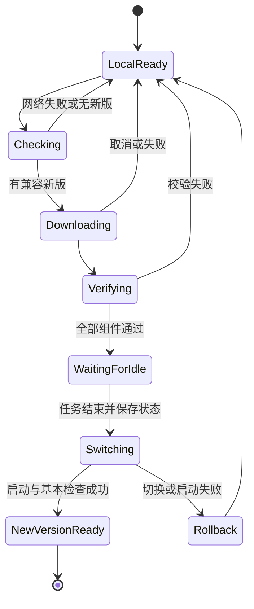

# 发布、更新与迭代路线图

记录日期：2026-10-03。范围：本轮工作区文本审查，以及 2026-10-01「比较 Slint 与 Flutter」中的发布、网络、组件更新和平台规划讨论。本文记录方案与验收门槛，不表示更新器、GUI 发布或 PWA 已实现。

相关文档：[选型依据](01-framework-decision.md)、[架构与平台](02-architecture-and-platforms.md)、[代码审查台账](03-code-review-and-fixes.md)、[恢复工作与验证 checkpoints](05-checkpoints-and-validation.md)。

## 状态与优先级

- **源码已改，未运行验证**：工作区存在相应修改，只经过阅读或文本检查。
- **部分完成**：有基础代码，但依赖、错误处理或交付链路仍有缺口。
- **待实现**：只有讨论方案或验收要求。
- **历史证据**：来自 2026-10-01 的源码、发布包或已有产物检查；本轮没有重测。

本文的 P1/P2/P3 表示迭代顺序。实际缺陷的严重性以[代码审查台账](03-code-review-and-fixes.md)为准。先完成兼容性、内存安全与构建接线，再建立发行验证，最后扩展预览与更新功能。新增功能不能替代尚未关闭的正确性问题。

## REL-001：先形成可验证的发行包

**优先级：P1；状态：部分完成。**

当前正在从旧 C CLI 迁移到 C 核心库、Rust CLI、多语言绑定和 Slint GUI。源码结构变化后，旧工作流中的路径、任务入口和分支触发条件不能直接沿用。

本轮已修改：

- [xmake.lua](../../xmake.lua)：固定库名为 `DanmakuFactory`，避免从检出目录名推导库名而使 FFI、导入库和打包名称不一致。
- [scripts/rust.lua](../../scripts/rust.lua)：向 Cargo 传入实际 C 库输出目录与链接类型，整理 release 和 musl 目标选择，构建/运行任务先处理 C 核心依赖。
- [scripts/package.lua](../../scripts/package.lua)：补充 `package_release_cli` 入口，按 Cargo 输出布局、目标三元组和自定义 `CARGO_TARGET_DIR` 定位 CLI，纳入已暂存的运行库。
- [build-release.yml](../../.github/workflows/build-release.yml)：调整源码触发路径、Rust 设置和 release CLI 打包调用。
- [build.yml](../../.github/workflows/build.yml)：覆盖 `main` 与 `master`；补充 Alpine 所需基础工具并整理 Rust 安装方式。

**尚未关闭：**

1. Rust 绑定仍把 `DF_XREPO_LIB_DIR` 当作单一路径，未拆解上游传入的多目录列表。
2. `DF_RUNTIME_DLL_DIRS` 已由 xmake 侧导出，但绑定尚未消费；Windows 暂存仍主要扫描 C 库输出目录。
3. 静态链接的完整依赖集合、链接顺序和目标平台系统库未经过实际链接验证。
4. GUI 构建、GUI 打包、许可证文件、运行库及真实发布产物的完整流水线尚未建立。
5. CLI 打包修改尚未执行，不代表已生成可用归档。

**验收：**在后续获准执行构建时，为每个平台从干净检出生成可定位的 CLI 与 GUI 归档；在无开发工具链的机器上解压即用；检查包内主程序、核心库、运行库、许可证、版本元数据和示例配置。发布工作流必须明确区分 CLI 与 GUI 资产，不能因 CLI 成功而标记 GUI 已就绪。

## REL-002：把运行时依赖计入完整部署成本

**优先级：P1；状态：待验证。**

历史检查观察到 Flutter Windows runner 依赖 `MSVCP140.dll`、`VCRUNTIME140.dll`、`VCRUNTIME140_1.dll`；历史 Slint 程序依赖 `VCRUNTIME140.dll`。两份测量 ZIP 都未包含完整 VC 运行库部署成本。

这些结果是历史样本依赖记录，不能推断当前 Release 的依赖必然相同。字幕预览加入 libass 后，还需计入 libass、字体支持、渲染器及可能附带字体的成本。C 核心的字体和正则依赖也需按静态/动态构建分别核对。

**实施要求：**

- 核查实际产物导入表和间接动态依赖，而非只复制名为 DanmakuFactory 的 DLL。
- 按所采用运行库的发行条件提供离线可用的部署方案。
- Linux 和 macOS 分别核对共享库搜索路径、可分发依赖与目标系统基线。
- 选择 WebView 路线时，把未预装 WebView2 的机器作为一个独立部署场景，计入离线运行时包。
- 不把开发机已有运行库、PATH 或 xmake 缓存当作用户机器条件。

**验收：**在干净系统、离线状态及含中文/空格的安装目录中启动、转换并保存配置；检查动态库缺失时能提供可理解的错误，而非静默退出。

## REL-003：保留体积比较的原始口径

**优先级：P2；状态：历史证据已归档，当前完整产品测量待办。**

原始记录已复制到 [framework-measurements-20261001.json](evidence/framework-measurements-20261001.json)。MiB 使用 `bytes / 1024 / 1024`。

| 样本 | ZIP 大小 | 解压文件总量 | 证据性质 |
|---|---:|---:|---|
| Flutter Windows v1.70.2 | 11.78 MiB | 28.11 MiB | 上游已发布 ZIP |
| 本地历史 Slint EXE + C DLL | 8.05 MiB | 18.55 MiB | 历史文件组合，未经完整发行验证 |
| 历史 Slint GUI EXE | — | 16.23 MiB | 已有文件 |
| Flutter 引擎 flutter_windows.dll | ZIP 条目约 7.77 MiB | 18.15 MiB | 上述 Flutter ZIP 内单个文件 |
| Flutter Dart 应用 data/app.so | ZIP 条目约 2.30 MiB | 5.84 MiB | 上述 Flutter ZIP 内单个文件 |

此前还记录过上游 Linux 包约 22.40 MiB、macOS 包约 49.58 MiB；这两项仅保留为关联对话的历史报告，未纳入当前 JSON 的 Windows 对照数据。

用户另报告 Slint release 单文件压缩约 3–4 MB。这是有价值的另一个样本，但构建特性、完整依赖与预览功能口径未统一。它不能与本地历史 EXE 组合强行互相否定。

**限制：**

- Flutter 本地源码版本、上游 release 和 Slint 历史源码/产物并不一致。
- 两份 Windows ZIP 不含完整 VC 运行库成本。
- 本轮没有重建、下载新包、测启动、内存、空闲 CPU、GUI 帧率或网络成功率。
- 2026-10-01 的新 Release 构建曾因缺少 Visual Studio C++ 工具链失败；这是此前的事件，不是本轮执行了构建。
- JSON 中“未修改源码”描述的是此前测量任务，不能用来描述本轮已发生的源码修复。

**后续测量：**固定同一 C 核心、同一预览功能、相同字体/资源、相同压缩算法和离线依赖口径，再比较首次完整下载量、一次纯 UI 更新量、一次核心修复更新量、启动耗时和转换性能。不要用源码行数直接代表质量或性能。

## REL-004：网络可达性与传输体积分开处理

**优先级：P2；状态：方案，尚无完整更新器。**

小包会缩短传输时间，并减少中断后的重试成本。DNS、TLS、连接建立、GitHub 下载重定向和服务端限流仍需下载链路处理。更换 GUI 框架并不能自动修复这些故障。

此前两套 GUI 均没有完整自动更新器。Flutter 的中国 SDK/依赖镜像服务于开发环境，不会自动加速本项目用户下载 GUI 发行包。Web 若只放在 GitHub Pages，同样受首次访问与资源更新的连通性影响。

**实施要求：**

1. 更新失败时，已安装版本仍可执行本地转换。
2. 后台检查设超时，避免阻塞启动和文件操作。
3. 使用有限重试、退避和取消；对可恢复故障给出明确反馈。
4. 正确处理资产下载重定向；断点续传仅在服务器实际支持时启用，并验证返回范围。
5. 缓存最近成功的版本元数据，控制访问频率，不依赖每次启动都请求 GitHub API。
6. 提供手动下载入口与可替换、由维护者控制的下载源；镜像只是传输渠道，真实性校验仍由客户端完成。
7. 如果采用 GitHub-only，仍需落实超时、缓存、失败恢复和手动入口。

[GitHub 资产下载接口](https://docs.github.com/en/rest/releases/assets)、[GitHub API 限流](https://docs.github.com/en/rest/using-the-rest-api/rate-limits-for-the-rest-api)、[Flutter 中国网络说明](https://docs.flutter.dev/community/china)为此前讨论的官方依据；本文未重新核实其 2026-10-03 内容。

## REL-005：完整性与真实性分别校验

**优先级：P2；状态：待实现。**

下载成功只说明收到了文件。包的大小/hash 可检测截断和意外损坏；可信的签名或等价发布信任机制用于证明内容来自维护者。若 hash 与资产一起从受影响的渠道获得，单独比对 hash 不能建立发布者真实性。

**建议发布元数据包含：**

| 字段 | 用途 |
|---|---|
| release_version、channel | 产品版本与更新渠道 |
| platform、architecture、minimum_os | 选择可运行的包 |
| core_abi、config_schema、required_capabilities | 判断组件兼容性 |
| components | 本次完整兼容集合及每个组件版本 |
| size、hash、download_urls | 校验文件和选择下载源 |
| signature、signing_key_id | 验证发布者及处理密钥轮换 |
| migration / rollback metadata | 配置迁移与回退策略 |

这是拟定的契约，不是当前已有 manifest 格式。实施时先确定最小版本，再扩展；密钥不能随意与未校验的更新内容同时替换。

**验收：**截断、hash 错误、错误平台、签名失败、过旧或不兼容组件必须在安装前拒绝；保留现有可用版本和可理解的日志。

## REL-006：建立独立于产品版本的 C ABI 契约

**优先级：P2；状态：公开 API 已有基础，独立更新契约待设计。**

[公开头文件](../../lib/include/danmakufactory.h)已经提供不透明句柄、UTF-8 JSON、typed 输入输出、错误码与线程局部错误查询。它是各语言复用核心的基础。

`df_get_version()` 返回产品版本字符串。它尚不能单独回答以下问题：

- 哪些函数/错误码可用，旧客户端所需 symbol 是否存在？
- 相同接口的单位、配置含义或输出行为是否发生不兼容变化？
- 新组件分配的内存由谁释放，旧组件能否安全消费？
- 字体注册、线程模型、错误字符串有效期是否一致？
- 预览 API 或 WASM 能力是否可用？

**建议：**分别定义 ABI 主版本、配置 schema 版本和能力查询；明确保持旧 symbol、增量扩展与破坏性升级规则。新增接口采用大小/版本明确的结构或保守的函数扩展方式，避免在公共 ABI 中暴露内部结构布局。

**验收：**旧 GUI/绑定能与承诺兼容的新核心完成 fixture 转换；不兼容组合在调用前被拒绝；错误字符串在同线程下一次 API 调用前复制，任何绑定都不得释放库内 TLS/静态字符串。

## REL-007：组件更新属于链接和发布设计

**优先级：P2；状态：讨论结论，待实现。**

| 变化 | Flutter | Slint | Qt 路线 |
|---|---|---|---|
| 兼容的 C 核心 DLL 修复 | 可只更新核心 | 可只更新核心 | 可只更新核心 |
| UI/应用修改 | 可更新匹配的应用代码与资源 | 可更新 GUI EXE，保留核心 DLL | 可更新应用，保留 Qt 库 |
| 框架/运行时升级 | 应提供匹配的完整组件集合 | 按实际运行时与打包方式更新 | 按 Qt 版本与模块更新 |
| C 核心静态进入单文件 EXE | 更新包含它的应用产物 | 更新整份 EXE | 更新包含它的应用产物 |

Flutter 引擎、应用代码、插件和资源可分开存放，不代表任意 SDK 版本的文件可以互换。Slint 静态单文件部署体积可能更小，但核心变化时仍要替换这个文件。外置 .slint 或 QML 也需要兼容性与加载信任设计，不能当作免费获得的安全热更新。

**实施顺序：**先提供完整包更新与回退；再做按文件 hash 下载变化的组件；只有实际更新流量仍是瓶颈时，才研究二进制差分。不要从首次 ZIP 体积直接推导每次更新量。

此前讨论依据：[Flutter Windows 产物](https://docs.flutter.dev/platform-integration/windows/building)、[Flutter ABI/code push FAQ](https://docs.flutter.dev/resources/faq)。

## REL-008：采用完整版本切换与可恢复安装

**优先级：P2；状态：待实现。**

原生更新建议先下载到独立暂存目录，校验全部组件，再切换到完整的新版本。不得在正在执行的转换中替换已加载的 C 库，或混合旧 UI 与不兼容的新核心。

推荐生命周期：

**验收：**模拟下载中断、磁盘不足、文件占用、安装权限不足、程序崩溃与新版本启动失败。每种失败都能继续使用旧版本或恢复到明确的可用状态。状态图是设计目标，当前未有对应运行实现。

## REL-009：配置迁移与回退纳入更新事务

**优先级：P2；状态：待实现。**

当前兼容性基准是既有文档与公开 API，不可通过静默重置旧配置来规避升级问题。更新器应先备份配置，明确 schema 迁移路径，再使新版消费迁移结果。

需要保留：字体名/路径大小写、正则表达式原文、嵌入黑名单、输入模板与时间偏移、坐标、旧 flat 配置和嵌套配置的覆盖语义。无效配置应报告具体字段，不能悄悄忽略并按默认参数输出。

**验收：**同一旧配置升级后语义等价；失败时旧配置仍在；回退到旧版不会被不可逆迁移阻断。CLI `--save` 当前只保存合并后的指定覆盖项，独立保存与完整默认值输出的文档契约尚未闭环，须在配置格式稳定前解决。

## REL-010：PWA 安装、离线和更新是独立 checkpoints

**优先级：P2；状态：待实现。**

当前 [HTML 页面](../index.html)与 [app.js](../app.js)是 C/WASM 转换入口基础。修正初始化和参数格式并不意味着已完成 Slint Web、可安装 PWA 或离线升级。

三项能力分别验收：

1. **SPA 可运行**：普通浏览器打开后加载 UI/核心，选择输入并下载结果。
2. **可安装**：HTTPS、Web App Manifest、图标、启动范围和支持安装的浏览器形成闭环。
3. **离线可用**：首次完整下载并缓存 UI、核心 WASM、胶水、字体、预览组件及必要资源后，断网仍能运行。

PWA 更新仅更新 Web 资源，不更新原生 EXE/DLL。浏览器安装能力因平台和版本而异；支持普通网页不能直接推断支持独立窗口安装。

此前依据：[PWA 安装指南](https://developer.mozilla.org/en-US/docs/Web/Progressive_web_apps/Guides/Making_PWAs_installable)、[Service Worker 生命周期处理](https://developer.chrome.com/docs/workbox/handling-service-worker-updates)。

## REL-011：Web 资源按完整兼容版本激活

**优先级：P2；状态：待实现。**

UI WASM、C 核心 WASM、JS 桥、预览 WASM 和字体必须组成经过验证的资源集合。推荐资源路径或缓存名包含 release 标识，避免把旧 UI 与新核心意外混用。

**建议流程：**

- 启动时使用当前已激活且完整的版本。
- 后台检查与下载新资源；缓存不完整时继续旧版。
- 下载全部完成后等待转换任务结束或下次启动。
- 保存配置/任务状态，再切换新 Service Worker 和资源版本。
- 保留受控的旧版本缓存用于失败恢复；之后再清理。
- 跨标签页协调任务和激活，避免一页更新影响另一页执行。

这能减少用户手动安装，但不保证应用关闭后仍实时更新；资源缓存也不等于已获得 WASM 二进制差分。Flutter Web 同样需要设计离线和缓存策略，不能把框架能输出 Web 当成 PWA 更新器已经存在。[Flutter Web FAQ](https://docs.flutter.dev/platform-integration/web/faq)为此前调研依据。

## REL-012：旧系统兼容入口以实测浏览器为边界

**优先级：P2；状态：目标待验证。**

此前选择的 Win7 兼容验证候选是 Firefox 115 ESR 与 Chrome 109。其支持政策属于 2026-10-01 的历史调研；后续正式承诺前需重新核实。IE11 没有纳入计划。

兼容层不能把 WebGPU、直接目录访问、系统字体枚举或浏览器独立窗口安装作为必要条件。保留普通文件选择、导入字体、结果下载与 Worker；必要时让用户以普通网页使用。

**验收：**分别确认加载、输入输出、转换、字体、预览、移动布局、离线与安装能力。Slint Web 和独立 HTML 界面是不同 UI 路线；按最新讨论先验证共享 Slint UI，仅在兼容目标无法满足时再维护简化 HTML 业务界面。

## REL-013：许可证与发布内容建立对应清单

**优先级：P1 发布门槛；状态：待整理。**

项目 MIT 许可不能替代依赖组件的发行义务。此前讨论：Flutter BSD 3-Clause；Slint 需明确选择免版税应用许可、GPLv3 或商业许可等路径，并落实相应归属展示；Qt 若采用 LGPL 路线，需要按模块和链接方式处理义务；libass 为 ISC，但所有传递依赖仍需核查。

这些是选型与发行检查点，未完成当前产品的逐组件法律审定。不能在发行说明中直接把所有依赖统称 MIT，也不能仅凭 Slint 可免费用就省略 AboutSlint/徽章等所选许可要求。

**验收：**包中依赖版本、许可证文本、通知/归属入口与实际链接组件一致；字体若随包发行，核对其单独授权；Windows 运行库按允许的方式分发。最新正式发行前核对采用的确切版本和官方许可原文。

## REL-014：外部 Flutter 项目问题保留边界

**优先级：P2；状态：此前发现，未在本仓库修复。**

此前检查的外部目录是 `D:\Shawn\Source\Repos\hihkm\DanmakuFactory\gui\danmakufactory_flutter`。它不在本轮源码修改范围内，以下问题不能因当前仓库增加 Dart 绑定而标成已解决：

- 输入/输出路径拼接命令字符串，含空格路径会在旧解析层拆开。
- GUI/插件复制旧核心，需迁移到统一 C 句柄或 JSON FFI。
- 若干鸿蒙插件引用分支或 master，桌面优先时需要锁定稳定来源；保留鸿蒙时需独立管理差异。
- widget 测试仍为计数器模板，相关测试依赖被注释，不能证明实际 GUI 行为。
- 桌面键盘操作、系统文件拖入、取消与错误恢复仍需按实际实现验证。

**验收：**若继续维护该 Flutter 入口，先迁移统一 API、消除命令字符串边界、锁定依赖，使用与本仓库相同 fixtures 核对输出；不能凭已有移动页面推断桌面已验证。

## 分阶段交付顺序

| 阶段 | checkpoint | 交付内容 | 完成门槛 |
|---|---|---|---|
| 0：恢复当前工作 | REL-015 | 保存问题、修复和证据状态 | 文档可追踪，源码修改与历史产物区分 |
| 1：关闭基础缺陷 | REL-016 | OOM/整数边界、CLI 文档兼容、构建路径和配置契约 | 文本复核完整；获准运行后通过针对性回归 |
| 2：建立原生发行 | REL-017 | CLI/Slint GUI 干净构建、离线依赖、版本和许可证 | 各目标平台包可用，错误路径可恢复 |
| 3：真实字幕预览 | REL-018 | C → ASS → libass → RGBA，去抖、后台渲染、时间轴与字体 | 与实际 ASS 播放结果一致，避免模拟 Text 预览误导 |
| 4：共享 Web 入口 | REL-019 | Slint UI Web、JS 服务桥、Worker、字体和窄屏布局 | 浏览器矩阵可运行，转换/过滤语义一致或能力差异显式报告 |
| 5：更新与交付优化 | REL-020 | 原生更新、PWA 缓存/版本切换、镜像和组件更新 | 故障回退、签名/校验、离线与配置迁移通过验收 |

### REL-015：文档 checkpoint

本轮当前目标。把历史建议的适用前提、当前未解决问题、源码修改及未执行验证写成可恢复记录。完成文档不能自动关闭任何源码缺陷。

### REL-016：基础缺陷 checkpoint

先处理[审查台账](03-code-review-and-fixes.md)中的未解决高优先级项目。特别关注消息动画 OOM 传播、字号/行高/屏幕坐标运算边界、Rust 路径列表消费、完整旧 CLI 参数契约和原生/WASM 正则差异。不要为了开展预览而跳过这些问题。

### REL-017：原生发行 checkpoint

现代 Windows/Linux/macOS 各平台、各架构仍需分别编译、打包和验证。共享源码节省重复实现，不免除原生多目标交付成本。是否正式支持某架构需形成明确清单，不以框架宣传的支持范围替代产品支持范围。

### REL-018：预览 checkpoint

第一版优先纯色/静态图背景和 timestamp 渲染，不引入视频解码依赖；参数变化重建 ASS，时间轴变化复用 ASS；采用 generation 丢弃过期渲染。之后才考虑内存 ASS 输出、缓存解析池与视频背景。[架构文档](02-architecture-and-platforms.md)保存接口边界和更详细步骤。

### REL-019：共享 Web checkpoint

先抽离文件、字体、任务调度、持久化和更新服务，再验证同源 .slint + Rust 逻辑与 C/Emscripten WASM 的双模块桥接。当前独立 HTML 页面可作为核心集成验证入口；它不是已完成的共享 Slint Web。

### REL-020：更新优化 checkpoint

先解决完整包的可靠下载、验证与回退，再减少更新流量。性能、内存、包体目标在获得可比较的当前产品数据后设定，不能把历史样本或未经实现的组件更新算成已达标优势。
